<picture>
  <source media="(prefers-color-scheme: light)" srcset="assets/header-light.svg" />
  
</picture>

  <a href="https://dsatracker.tech" title="DSA Tracker, in production">dsatracker.tech</a>&ensp;&ensp;
  <a href="https://anki1kr.me" title="The portfolio gate">anki1kr.me</a>&ensp;&ensp;
  <a href="https://www.linkedin.com/in/anki1kr">LinkedIn</a>&ensp;&ensp;
  <a href="mailto:ankitkumar67930@gmail.com">Email</a>

## Who's watching?

The front door of [anki1kr.me](https://anki1kr.me) asks that question, and so does this page. Pick the way in that fits how you like to look at work. Each picture opens the live thing.

<table>
<tr>
<td width="33%" align="center" valign="top">
<a href="https://anki1kr.me/aura/">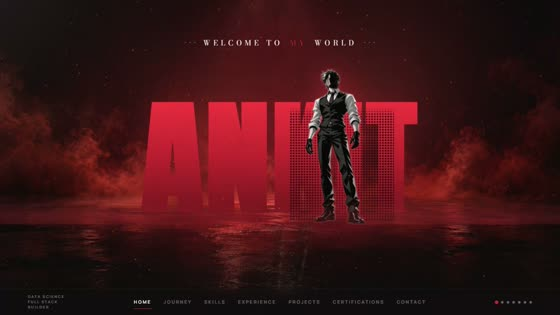</a>
 <b><a href="https://anki1kr.me/aura/">Developer</a></b>
 A cinematic résumé you scroll through.
</td>
<td width="33%" align="center" valign="top">
<a href="https://anki1kr.me/space.html">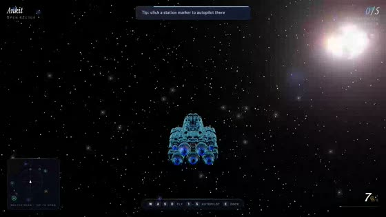</a>
 <b><a href="https://anki1kr.me/space.html">Creative</a></b>
 A small open world you fly a ship through.
</td>
<td width="33%" align="center" valign="top">
<a href="https://dsatracker.tech">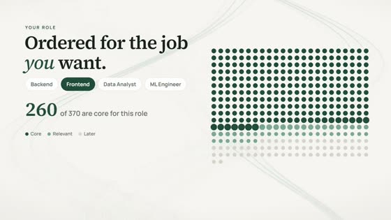</a>
 <b><a href="https://dsatracker.tech">DSA Tracker</a></b>
 The product I run. Try it with no account.
</td>
</tr>
</table>

<picture>
  <source media="(prefers-color-scheme: light)" srcset="assets/stats-light.svg" />
  
</picture>

I build complete products: the database, the API on it, the LLM pipeline behind it, and the frontend that makes sense of it. Everything I run is on free tiers, which is where I learned failover, caching and quota handling: each one broke in front of someone before I fixed it.

**Current focus:** the first hour of a new DSA Tracker user. Fewer clicks to the first solved problem, pages that do not shift while they load, and AI help that never leaves a blank screen.

On this page:&ensp;<a href="#dsa-tracker">DSA Tracker</a>&ensp;<a href="#the-resume">Résumé</a>&ensp;<a href="#the-flight-portfolio">Flight portfolio</a>&ensp;<a href="#open-source">Open source</a>&ensp;<a href="#internship-and-analysis-work">Internships</a>&ensp;<a href="#timeline">Timeline</a>&ensp;<a href="#contact">Contact</a>

## DSA Tracker

**In production at [dsatracker.tech](https://dsatracker.tech).** Source is private while it runs as a business.

It answers one question: what should I solve next for my target role? A curated dataset of 370 problems across 22 topics, reordered for 30 job roles. No account is needed to try it: one click lands on the first problem.

<a href="https://dsatracker.tech" title="Open DSA Tracker">
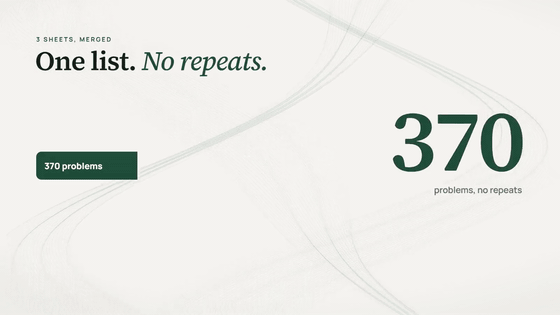
</a>

From the product's own film: pick a role, solve in the browser, watch an algorithm run step by step.

<a href="https://dsatracker.tech/problems" title="Open the role view on dsatracker.tech">
<picture>
  <source media="(prefers-color-scheme: light)" srcset="assets/roles-light.svg" />
  
</picture>
</a>
Pick any of the 30 roles yourself: <a href="https://dsatracker.tech/problems">dsatracker.tech/problems</a>

<a href="https://dsatracker.tech/visualize/arrays-two-sum" title="Step through this walkthrough on dsatracker.tech">
<picture>
  <source media="(prefers-color-scheme: light)" srcset="assets/two-sum-light.svg" />
  
</picture>
</a>
Step through it yourself: <a href="https://dsatracker.tech/visualize/arrays-two-sum">dsatracker.tech/visualize/arrays-two-sum</a>. Then solve it in the editor: <a href="https://dsatracker.tech/compiler">dsatracker.tech/compiler</a>

<picture>
  <source media="(prefers-color-scheme: light)" srcset="assets/cascade-light.svg" />
  
</picture>

- Animated algorithm visualizers: step-through traces generated by running the real algorithm and recording its state.
- An in-browser editor and judge in 9 languages, and progress pulled from 6 platforms (LeetCode, Codeforces, CodeChef, GeeksforGeeks, AtCoder, HackerRank).
- AI help that fails over across several free-tier providers, so a quota or a cut-short answer never leaves a blank screen.

<code title="the dashboard and every rendered page">next.js</code> <code title="typed frontend, shared types with the api">typescript</code> <code title="the backend api">fastapi</code> <code title="backend logic and the failover layer">python</code> <code title="the 370-problem dataset and every user's progress">postgres</code>

## The résumé

**[anki1kr.me/aura](https://anki1kr.me/aura/).** One page, seven scenes, all of it driven from a single content file: the hero, the journey, skills, experience, projects on a turning drum, certifications and contact. It scrolls with inertia, and every scene works on a phone too.

<a href="https://anki1kr.me/aura/" title="Scroll the résumé">
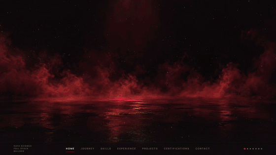
</a>

Recorded from the live page. Scroll it yourself: <a href="https://anki1kr.me/aura/">anki1kr.me/aura</a>

<code title="scroll-driven scenes and timelines">gsap</code> <code title="inertial scrolling">lenis</code> <code title="the ember particles">three.js</code>

## The flight portfolio

**[anki1kr.me/space.html](https://anki1kr.me/space.html).** Instead of a scrolling page, a small open world in Three.js WebGL with no build step. You pilot a ship between planets named About, Skills, Projects, Education and Contact. Land on one and an astronaut steps out, plants a flag, and the section opens.

<a href="https://anki1kr.me/space.html" title="Take the ship out">
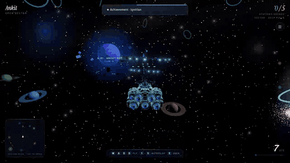
</a>

Recorded from the live site. Fly it yourself: <a href="https://anki1kr.me/space.html">anki1kr.me/space.html</a>. Keys: W A S D to fly. In a hurry? A recruiter quick-view skips the flying.

<b>How it stays fast</b>

 

- The ship and station are modelled in Blender and exported as GLB.
- Draco compression took the models from about 18 MB to 3.5 MB, and launch-ready time from about 10 s to 4.6 s.
- A custom GLSL world-space joystick for phones, plus a radar map of the whole sector.
- The landing cinematic (astronaut, flag, wave) is skippable and respects reduced motion.

<code title="renders the whole 3d world">three.js</code> <code title="what three.js draws through">webgl</code> <code title="the custom mobile joystick shader">glsl</code> <code title="where the ship and station were modelled">blender</code> <code title="compressed the models about 5x for a fast load">draco</code>

## Open source

<a href="https://github.com/search?q=author%3Aanki1kr+is%3Apr&type=pullrequests" title="Every pull request, on GitHub">
<picture>
  <source media="(prefers-color-scheme: light)" srcset="assets/prs-light.svg" />
  
</picture>
</a>
Read them: <a href="https://github.com/search?q=author%3Aanki1kr+is%3Apr&type=pullrequests">all pull requests on GitHub</a>

[9router](https://github.com/decolua/9router) and [OmniRoute](https://github.com/diegosouzapw/OmniRoute) are self-hosted LLM routers, the tooling my own projects run on.

## Internship and analysis work

- [Agriculture-Agribusiness](https://github.com/anki1kr/Agriculture-Agribusiness): pre-harvest crop yield forecasting across 320 districts (2009 to 2023) from MODIS NDVI, ERA5-Land weather and SoilGrids data. LightGBM with leave-one-year-out validation; out-of-sample MAPE from 15.4% to 7.4%.
- [healthcare](https://github.com/anki1kr/healthcare): 30-day readmission risk across chronic-disease cohorts, with the operational and financial impact under the CMS Hospital Readmissions Reduction Program.
- [crawler](https://github.com/anki1kr/crawler): Orbit, an LLM browser agent as a Chrome extension (MV3) with a local bridge.

## Timeline

<picture>
  <source media="(prefers-color-scheme: light)" srcset="assets/timeline-light.svg" />
  
</picture>

## Stack

- **Backend and data:** Python, FastAPI, Flask, PostgreSQL, Pandas, NumPy.
- **Frontend and 3D:** TypeScript, Next.js, React, Tailwind, GSAP, Three.js, GLSL, Blender.
- **Automation and analysis:** Playwright, Chrome extensions (MV3), SQL, Power BI.
- **Learning now:** statistical reasoning, async patterns, prompt design that holds up in production.

## Activity

<picture>
  <source media="(prefers-color-scheme: dark)" srcset="https://raw.githubusercontent.com/anki1kr/anki1kr/output/github-contribution-grid-snake-dark.svg" />
  
</picture>

## Contact

<a href="https://www.linkedin.com/in/anki1kr">linkedin.com/in/anki1kr</a>&ensp;&ensp;<a href="mailto:ankitkumar67930@gmail.com">ankitkumar67930@gmail.com</a>&ensp;&ensp;<a href="https://anki1kr.me">anki1kr.me</a>&ensp;&ensp;<a href="https://leetcode.com/anki1kr/">leetcode.com/anki1kr</a>

Open to collaboration on LLM tooling, data pipelines and browser automation.

<b>How this page is made</b>

 

The animated panels are drawn by <code>assets/build.mjs</code> from <code>assets/profile-data.json</code>, which is exported from the project code, so no number on them is typed by hand. The three moving pictures of live sites in <code>assets/media</code> are recordings of the real pages.

